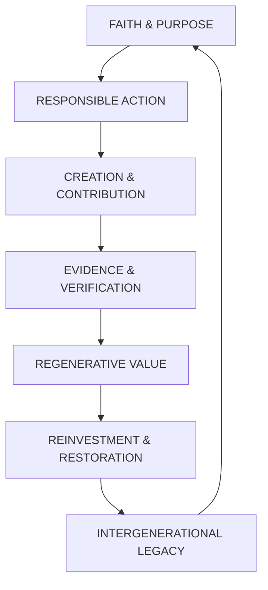
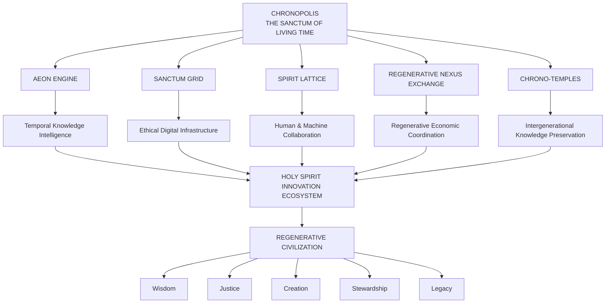
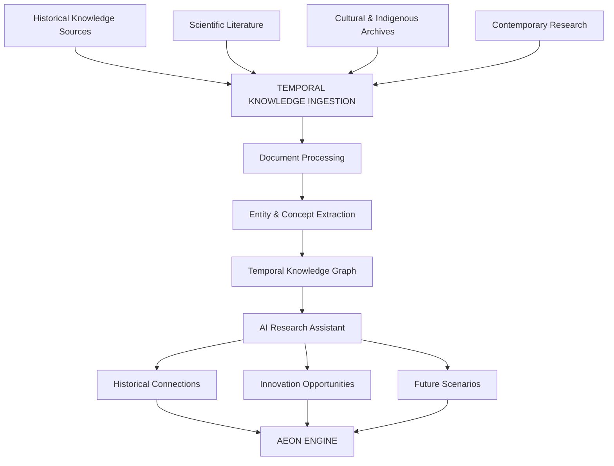
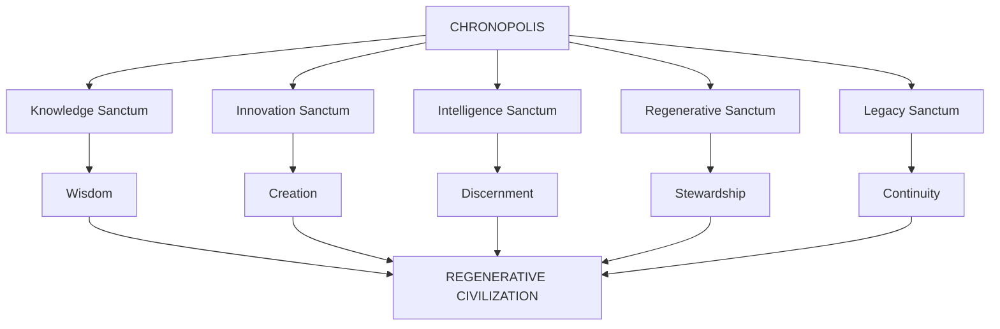
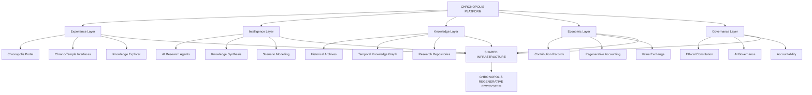

# 🕊️ CHRONOPOLIS
## The Sanctum of Living Time

### Where Divine Intelligence, Human Innovation, and the Continuum of Creation Converge.

  <strong>A TRANSTEMPORAL REGENERATIVE CIVILIZATION VISION</strong>
   
  <em>Redeeming time through wisdom, harmonizing innovation with virtue, and building a civilization where creation serves life.</em>

  <a href="#-essence">Essence</a> •
  <a href="#-foundational-architecture">Architecture</a> •
  <a href="#-engineering-vision">Engineering</a> •
  <a href="#-holy-spirit-innovation-ecosystem">Ecosystem</a> •
  <a href="#-scientific--philosophical-foundations">Research</a> •
  <a href="#-roadmap">Roadmap</a>

---

> "Chronopolis is not built by hands alone, but through hearts aligned with the eternal rhythm of creation."

---

# 🌌 01. The Essence

Chronopolis is not merely a city.

It is a conceptual living meta-system that explores the convergence of time, consciousness, intelligence, spirituality, and regenerative civilization.

Inspired by the vision of the New Jerusalem, the wisdom of humanity's greatest thinkers, and the creative possibilities of emerging technologies, Chronopolis proposes a new architectural paradigm for civilization.

Its foundation is the **Holy Spirit Innovation Ecosystem** — a spiritual-technological framework where scientific discovery, ethical intelligence, human creativity, and acts of compassion contribute to the restoration and advancement of civilization.

Chronopolis envisions a world where:

- Historical knowledge becomes accessible to future generations.
- Scientific discoveries connect across disciplines and civilizations.
- Artificial intelligence develops within ethical and constitutional boundaries.
- Innovation becomes an instrument of service and restoration.
- Economic systems recognize meaningful human and ecological contributions.
- Wisdom is preserved across generations.
- Technology supports human dignity, spiritual reflection, and planetary wellbeing.

The central proposition is that humanity should not merely optimize the present.

It should learn from the past, act responsibly in the present, and consciously design the future.

**Chronopolis transforms time from a dimension we pass through into a resource for learning, regeneration, and collective wisdom.**

---

# 🕊️ 02. The Mission

To redeem time by transforming innovation into service, knowledge into wisdom, and civilization into a sanctuary for life.

Chronopolis seeks to heal the fragmentation between:

| Fragmentation | Chronopolis Vision |
|---|---|
| Economics without ethics | Value aligned with virtue and responsibility |
| Technology without humanity | Intelligence guided by human dignity |
| Knowledge without continuity | Intergenerational wisdom preservation |
| Innovation without purpose | Creation directed toward meaningful service |
| Progress without stewardship | Regenerative civilization |
| Intelligence without discernment | Accountable and ethically governed AI |
| Time without reflection | Conscious use of historical and future knowledge |

Our mission draws inspiration from the belief that creation carries responsibility.

Technology should not merely increase humanity's capabilities. It should help humanity become wiser in how those capabilities are used.

---

# 🏛️ 03. Foundational Architecture

Chronopolis is built around five interconnected conceptual pillars.

## I. The Aeon Engine
### The Intelligence of Living Time

The Aeon Engine represents the temporal intelligence layer of Chronopolis.

Its purpose is to connect historical knowledge, present-day observations, and future-oriented simulations into one interconnected knowledge environment.

Rather than treating historical information as disconnected archives, the Aeon Engine explores how humanity's accumulated discoveries can inform contemporary innovation.

### Conceptual Capabilities

**Historical Intelligence**
- Historical scientific discoveries.
- Ancient engineering knowledge.
- Lost and overlooked inventions.
- Historical civilizations and technologies.
- Indigenous knowledge systems.
- Philosophical and spiritual traditions.

**Temporal Knowledge Mapping**
- Connections between historical inventions.
- Evolution of scientific theories.
- Relationships between discoveries.
- Intergenerational knowledge networks.
- Historical research provenance.

**Future Intelligence**
- Predictive modelling.
- Scenario simulation.
- Technological forecasting.
- Long-term civilization planning.
- Alternative development pathways.

### The Three Temporal Dimensions

| Dimension | Function |
|---|---|
| Past | Recover, preserve, and interpret human knowledge |
| Present | Connect observations, innovations, and decisions |
| Future | Explore possible scenarios and consequences |

### Foundational Inspiration

*"The Spirit renews the face of the Earth." — Psalm 104:30*

The Aeon Engine symbolizes the renewal of knowledge across generations.

Its scientific implementation can draw from temporal databases, knowledge graphs, artificial intelligence, historical archives, and computational scenario modelling.

The concept of a quantum-temporal reactor remains speculative rather than an established scientific technology.

---

## II. Sanctum Grid
### The Ethical Nervous System of Civilization

The Sanctum Grid represents a proposed distributed intelligence and coordination infrastructure.

It connects institutions, knowledge systems, digital services, AI agents, communities, and regenerative initiatives.

Its defining characteristic is the integration of ethical principles into technology governance.

### Conceptual Capabilities

- Distributed intelligence.
- AI governance frameworks.
- Ethical policy enforcement.
- Institutional coordination.
- Verifiable digital identities.
- Knowledge interoperability.
- Transparent decision systems.
- Regenerative infrastructure monitoring.

### The Sanctum Grid Philosophy

Technology should not be evaluated solely by efficiency, computational power, or economic output.

It should also be examined through:

- Truth.
- Justice.
- Human dignity.
- Responsibility.
- Compassion.
- Transparency.
- Ecological integrity.

The Sanctum Grid explores how these principles can become operational requirements within intelligent infrastructure.

### City of God — Moral Architecture in Code

The spiritual inspiration is the idea that a civilization's foundations should reflect justice, wisdom, and love.

Its engineering expression is accountable digital infrastructure.

---

## III. Spirit Lattice
### The Architecture of Connection

The Spirit Lattice represents the relational intelligence layer of Chronopolis.

It explores how human creativity, institutional knowledge, artificial intelligence, and spiritual reflection can coexist within a framework of mutual respect and accountability.

Its name is inspired by the Holy Spirit as the sustaining and unifying presence within the project's theological vision.

Its technological interpretation focuses on communication, knowledge exchange, and human-AI collaboration.

### Conceptual Capabilities

- Human-AI collaboration.
- Distributed communication.
- Knowledge exchange.
- Context-aware intelligence.
- Collaborative research.
- Ethical coordination.
- Human-centered AI interfaces.
- Collective problem-solving.

### Three Dimensions of Intelligence

| Dimension | Contribution |
|---|---|
| Human Intelligence | Experience, creativity, empathy, and judgment |
| Machine Intelligence | Computation, analysis, synthesis, and automation |
| Collective Intelligence | Cooperation, shared knowledge, and institutional wisdom |

### Foundational Principle

Intelligence should become more than the ability to calculate.

It should support the ability to understand, discern, collaborate, and create responsibly.

The Spirit Lattice is a philosophical and architectural concept, not a claim that machines can establish supernatural communication with angels or access divine consciousness.

---

## IV. Regenerative Nexus Exchange (RNE)
### The Economy of Creation, Contribution, and Stewardship

The Regenerative Nexus Exchange is the proposed economic coordination layer of Chronopolis.

It explores how economic systems can recognize contributions that generate meaningful social, intellectual, environmental, and cultural value.

Its philosophy is inspired by the relationship between faith, works, responsibility, and enduring legacy.

### The Regenerative Value Cycle

### Potential Capabilities

**Regenerative Contribution Records**
- Environmental restoration.
- Scientific discovery.
- Educational contributions.
- Community service.
- Cultural preservation.
- Collaborative innovation.

**Value Coordination**
- Contribution recognition.
- Evidence-based impact records.
- Regenerative project financing.
- Transparent allocation mechanisms.
- Community participation.

**Economic Intelligence**
- Social value assessment.
- Environmental impact analysis.
- Long-term contribution tracking.
- Regenerative investment models.

### A New Understanding of Value

Chronopolis explores the idea that wealth should be understood through more than financial accumulation.

Knowledge, compassion, innovation, restoration, and intergenerational contribution are important dimensions of human prosperity.

Spiritual virtue itself is not a scientifically measurable or automatically tradable commodity. The RNE's measurable economic mechanisms should instead recognize documented actions, contributions, and verified outcomes.

### Foundational Philosophy

**Faith → Works → Value → Legacy**

The ultimate objective is to align economic incentives with meaningful contributions to humanity and the living world.

---

## V. Chrono-Temples
### Sanctuaries of Knowledge and Regeneration

Chrono-Temples are conceptual physical and digital knowledge sanctuaries distributed across different civilizations.

They represent places where historical understanding, scientific research, spiritual reflection, and technological innovation converge.

Each Chrono-Temple would serve as a center for knowledge preservation, education, interdisciplinary research, and regenerative innovation.

### Conceptual Capabilities

- Historical knowledge archives.
- Scientific research collections.
- Digital heritage preservation.
- AI-assisted knowledge discovery.
- Research collaboration.
- Educational experiences.
- Regenerative innovation laboratories.
- Cultural documentation.

### The Library of Redemption

The Library of Redemption is the envisioned knowledge architecture connecting human discoveries, lessons, inventions, and regenerative contributions.

It preserves knowledge so future generations can learn from the achievements and mistakes of those who came before them.

### Potential Chrono-Temple Locations

| Location | Conceptual Focus |
|---|---|
| Nairobi, Kenya | African innovation and regenerative intelligence |
| Rome, Italy | Historical civilization and institutional wisdom |
| Kyoto, Japan | Philosophy, harmony, and technological refinement |
| Machakos, Kenya | Community innovation and regenerative development |
| Jerusalem | Spiritual heritage and theological reflection |

These locations represent visionary possibilities, not established physical facilities or confirmed partnerships.

### Foundational Inspiration

*"Your deeds follow you." — Revelation 14:13*

Chrono-Temples symbolize the preservation of meaningful human contribution across generations.

---

# 🧬 04. The Chronopolis Civilization Architecture

The five pillars work together as one interconnected system.

### The Integrated System

| System | Core Question |
|---|---|
| Aeon Engine | What can humanity learn across time? |
| Sanctum Grid | How should intelligent systems behave? |
| Spirit Lattice | How can intelligence collaborate responsibly? |
| RNE | How can meaningful contributions create regenerative value? |
| Chrono-Temples | How can knowledge and wisdom endure? |

Together, the five systems form the conceptual foundation of Chronopolis.

---

# 🕊️ 05. Holy Spirit Innovation Ecosystem

Chronopolis belongs to the broader Holy Spirit Innovation Ecosystem, an interconnected vision integrating spiritual philosophy, advanced technology, ethical intelligence, and planetary stewardship.

The ecosystem is designed around complementary technological and philosophical initiatives.

## I. Guardian-IO
### The Guardian of Ethical Intelligence

Guardian-IO provides the conceptual protection and governance layer.

Its role is to help ensure that intelligent systems operate within appropriate boundaries of safety, responsibility, and accountability.

Potential domains:
- AI safety.
- Constitutional AI.
- Cybersecurity.
- Identity protection.
- Governance enforcement.
- System integrity.

**Chronopolis Function:** The moral and security architecture of the city.

## II. Aeonexus
### The Bridge of Interconnected Civilizations

Aeonexus represents a broader platform for connecting knowledge, institutions, innovation, and planetary systems.

Potential domains:
- Global knowledge networks.
- Climate intelligence.
- Regenerative infrastructure.
- Cross-sector collaboration.
- AI-powered coordination.
- Sustainable development.

**Chronopolis Function:** The interconnecting infrastructure through which knowledge and innovation move across civilizations.

## III. Genesis360
### The Intelligence of Living Systems

Genesis360 represents the life-system intelligence dimension of the ecosystem.

Its conceptual scope includes:
- Ecological information.
- Biological systems.
- Cultural knowledge.
- Human development.
- Environmental relationships.
- Regenerative science.

**Chronopolis Function:** Understanding and supporting the interconnected systems that sustain life.

## IV. Regenerative Value Exchange
### The Circulatory System of Regenerative Prosperity

The broader Regenerative Value Exchange provides the economic foundation for measuring and coordinating regenerative contributions.

Potential domains:
- Impact accounting.
- Regenerative assets.
- Environmental restoration.
- Social contribution.
- Sustainable investment.
- Transparent value allocation.

**Chronopolis Function:** Connecting meaningful creation with measurable regenerative outcomes.

## V. Harmonia AI
### The Orchestration of Intelligence

Harmonia AI represents the intelligence coordination vision of the ecosystem.

Its role is to explore how different AI systems and human participants can collaborate within a coherent ethical framework.

Potential domains:
- Multi-agent coordination.
- Ethical decision support.
- Knowledge synthesis.
- Creative collaboration.
- System optimization.
- Human-centered intelligence.

**Chronopolis Function:** Harmonizing innovation, reasoning, and collaboration across the city.

### Ecosystem Integration

| Atlas Sanctum Initiative | Chronopolis Role |
|---|---|
| Guardian-IO | Ethical protection and AI governance |
| Aeonexus | Interconnected knowledge and civilization infrastructure |
| Genesis360 | Biological, ecological, and cultural intelligence |
| Regenerative Value Exchange | Regenerative economic coordination |
| Harmonia AI | Intelligent orchestration and collaboration |

---

# ⚙️ 06. Engineering Vision
## From Spiritual Philosophy to Technological Architecture

Chronopolis combines a spiritual worldview with a conceptual engineering architecture.

The distinction between inspiration and implementation is fundamental.

The project draws upon quantum mechanics, artificial intelligence, distributed systems, computational modelling, historical knowledge engineering, regenerative economics, and systems science.

It does not claim that established physics currently allows humanity to extract energy or information from time, measure divine inspiration, or operate supernatural computational systems.

Instead, these ideas serve as conceptual foundations for research into implementable technologies.

## I. Temporal Data Harvesters

**Concept:** Recovering overlooked human knowledge.

Potential engineering manifestation:

- AI-powered historical document discovery.
- Digital archives.
- Knowledge graph construction.
- Optical and semantic document indexing.
- Scientific literature analysis.
- Cross-era invention mapping.

Example research objective:

Discover overlooked historical engineering ideas and assess whether they can inspire contemporary technological development.

## II. Aeonic Reservoirs

**Concept:** Preserving accumulated wisdom and regenerative contributions.

Potential engineering manifestation:

- Knowledge repositories.
- Evidence-backed contribution records.
- Historical project databases.
- Intergenerational archives.
- Regenerative impact records.
- Long-term information preservation.

The term "virtue energy" is a philosophical metaphor for ethical contribution, not a measurable physical energy source.

## III. Spirit-Driven Quantum Processors

**Concept:** Intelligence guided by discernment, truth, beauty, and utility.

Potential engineering manifestation:

- Quantum computing research.
- Advanced optimization.
- AI alignment frameworks.
- Ethical evaluation systems.
- Multi-objective decision modelling.
- Human-AI collaborative research.

Quantum computing should only be applied where appropriate computational advantages can be demonstrated. Moral values do not automatically become quantum computational operations.

## IV. Chrono-Sanctums

**Concept:** Physical and digital knowledge hubs.

Potential engineering manifestation:

- Innovation laboratories.
- Research institutions.
- Digital heritage centers.
- Community learning environments.
- Regenerative technology demonstration facilities.
- Interconnected research networks.

## V. Bio-Temporal Holographs

**Concept:** Environments responsive to living systems and human participation.

Potential engineering manifestation:

- Interactive spatial computing.
- Digital twins.
- Biosensing research.
- Environmental monitoring.
- Adaptive architecture.
- Immersive visualization.
- Responsive building systems.

These technologies can respond to measured environmental and human-interface inputs. Claims about buildings directly sensing prayer or supernatural moral energy remain spiritual symbolism rather than established engineering capabilities.

---

# 🔬 07. Scientific & Philosophical Foundations

Chronopolis seeks to create a meaningful dialogue between science, philosophy, theology, and engineering.

The purpose is not to claim that these disciplines are interchangeable.

It is to explore where their questions, methods, and aspirations can productively inform one another.

| Discipline | Philosophical Inspiration | Research Direction |
|---|---|---|
| Quantum Mechanics | Possibility and interconnectedness | Quantum information and computation |
| General Relativity | The structure of spacetime | Temporal modelling and cosmology |
| Thermodynamics | Entropy and renewal | Resilience and regenerative systems |
| Artificial Intelligence | Wisdom and discernment | Responsible and aligned AI |
| Information Theory | Knowledge and communication | Knowledge preservation and transfer |
| Economics | Generosity and stewardship | Regenerative economic systems |
| Cybernetics | Harmony and feedback | Adaptive civilization infrastructure |
| Systems Science | Unity and interdependence | Complex systems modelling |
| Theology | Creation and divine purpose | Spiritual philosophy and ethical reflection |

### Theological Inspirations

**Psalm 104:30**

A vision of renewal and the continuous sustaining of creation.

**Revelation 14:13**

A reflection on enduring contributions and the legacy of meaningful deeds.

**The New Jerusalem**

A symbolic inspiration for a civilization founded upon righteousness, peace, and divine order.

### The Scientific Standard

Chronopolis welcomes ambitious scientific exploration while maintaining a clear distinction between:

- Established scientific findings.
- Active research hypotheses.
- Engineering proposals.
- Philosophical interpretations.
- Theological convictions.
- Speculative future concepts.

This distinction protects both scientific integrity and spiritual meaning.

---

# 🧠 08. The Aeon Engine — Temporal Knowledge Intelligence

The Aeon Engine deserves a dedicated development path because it can provide one of Chronopolis's earliest technically demonstrable capabilities.

### Proposed Architecture

### Potential Applications

**Lost Knowledge Discovery**

Find historical documents, overlooked research, and forgotten technical discoveries.

**Innovation Genealogy**

Understand how contemporary inventions evolved through earlier ideas.

**Cross-Civilizational Knowledge**

Connect African, Asian, European, Middle Eastern, Indigenous, and other intellectual traditions.

**Future Scenario Exploration**

Use historical patterns and present information to investigate possible futures.

**Knowledge Regeneration**

Make underrepresented discoveries accessible to future researchers and innovators.

### Initial Research Challenges

- Historical source reliability.
- Multilingual document retrieval.
- Historical terminology.
- Intellectual property.
- Cultural attribution.
- Knowledge provenance.
- AI-generated misinformation.

The Aeon Engine should preserve original sources and distinguish historical evidence from AI-generated interpretations.

---

# 🏙️ 09. Chronopolis as a Living Civilization

Chronopolis is envisioned as a distributed city of knowledge and regeneration rather than a single centralized geographical location.

Its architecture connects physical sanctuaries, digital infrastructure, research networks, and communities.

### Five Operational Environments

**1. The Knowledge Sanctum**

Preserving humanity's historical, scientific, philosophical, and cultural knowledge.

**2. The Innovation Sanctum**

Developing technologies that address meaningful global challenges.

**3. The Intelligence Sanctum**

Exploring responsible AI, computational research, and collaborative intelligence.

**4. The Regenerative Sanctum**

Connecting innovation with ecological restoration and human development.

**5. The Legacy Sanctum**

Preserving contributions and knowledge across generations.

### The Living City Model

---

# 📜 10. The Chronopolis Charter

The Chronopolis Charter establishes the philosophical and ethical principles intended to guide the development of the ecosystem.

### Article I — Sacredness of Human Dignity

Every person possesses inherent dignity and should be treated with respect, compassion, and justice.

### Article II — Truth and Intellectual Integrity

Scientific claims must be supported by evidence. Historical knowledge must retain provenance. Spiritual convictions should be represented honestly.

### Article III — Responsible Intelligence

AI systems must operate within transparent boundaries of safety, accountability, and human oversight.

### Article IV — Freedom of Conscience

The ecosystem should respect individual spiritual autonomy, religious diversity, and freedom of belief.

### Article V — Stewardship of Creation

Technology and economic activity should support ecological responsibility and the protection of life.

### Article VI — Wisdom Across Generations

Knowledge should be preserved responsibly and made accessible to future generations.

### Article VII — Ethical Prosperity

Economic mechanisms should reward meaningful contributions without commodifying human dignity or spiritual worth.

### Article VIII — Transparency and Accountability

Institutions and technological systems must be open to appropriate scrutiny, review, and correction.

### Article IX — Responsible Innovation

Innovation should consider its long-term effects on people, societies, ecosystems, and future generations.

### Article X — Unity Without Coercion

Collaboration must preserve diversity, individual freedom, and meaningful participation.

---

# 🌍 11. Impact & Civilizational Outcomes

Chronopolis aims to explore how technology and wisdom can contribute to long-term civilizational regeneration.

### Knowledge Regeneration

- Preserve overlooked historical discoveries.
- Connect researchers across generations.
- Expand access to educational resources.
- Support interdisciplinary innovation.

### Ethical Intelligence

- Advance responsible AI governance.
- Improve transparency in autonomous systems.
- Develop human-centered intelligence frameworks.
- Encourage ethical technical research.

### Ecological Restoration

- Support regenerative projects.
- Improve environmental knowledge sharing.
- Connect technology with restoration initiatives.
- Enable evidence-based stewardship.

### Economic Regeneration

- Recognize documented social contributions.
- Improve transparent impact accounting.
- Encourage long-term value creation.
- Explore regenerative investment models.

### Cultural Continuity

- Preserve historical knowledge.
- Support cultural heritage.
- Connect intellectual traditions.
- Encourage intergenerational mentorship.

---

# 🧪 12. Research & Innovation Domains

Chronopolis invites interdisciplinary exploration across fields that are often developed independently.

| Research Domain | Proposed Focus |
|---|---|
| Quantum Computing | Advanced computation and information processing |
| Temporal Databases | Historical and evolving knowledge systems |
| Artificial Intelligence | Responsible intelligence and knowledge synthesis |
| Knowledge Graphs | Relationships across discoveries and civilizations |
| Distributed Systems | Interconnected research infrastructure |
| Cybernetics | Adaptive and feedback-driven systems |
| Digital Twins | Simulation of complex environments |
| Regenerative Economics | Contribution-oriented value systems |
| Philosophy | Ethics, purpose, and human flourishing |
| Theology | Faith, creation, discernment, and responsibility |
| Cultural Informatics | Preservation of historical knowledge |
| Environmental Science | Planetary stewardship |

---

# 🏗️ 13. Technical Architecture

The practical implementation of Chronopolis can begin with modular digital infrastructure.

### Conceptual Architecture

### Engineering Principles

- Modular system architecture.
- Interoperable knowledge infrastructure.
- Traceable source attribution.
- Secure information storage.
- Responsible AI integration.
- Transparent governance.
- Reproducible research workflows.
- Human-centered design.
- Privacy protection.
- Long-term preservation.

Implementation technologies should be selected according to validated technical requirements rather than assuming that speculative concepts require quantum hardware or exotic physics.

---

# 🗺️ 14. Development Roadmap

Chronopolis should progress from a digital knowledge and innovation platform toward an interconnected research and regenerative ecosystem.

## Phase I — The Digital Sanctum

- [ ] Establish Chronopolis identity and design philosophy.
- [ ] Develop the digital landing experience.
- [ ] Build the five-pillar architecture.
- [ ] Establish the Chronopolis Charter.
- [ ] Create the knowledge portal.
- [ ] Develop research documentation.

## Phase II — The Aeon Engine

- [ ] Develop historical document ingestion.
- [ ] Build a searchable knowledge archive.
- [ ] Implement knowledge graph foundations.
- [ ] Introduce historical entity extraction.
- [ ] Develop AI-assisted research.
- [ ] Establish source provenance.

## Phase III — Sanctum Grid

- [ ] Design ethical AI governance frameworks.
- [ ] Develop identity and authorization models.
- [ ] Build interoperable service interfaces.
- [ ] Introduce policy evaluation.
- [ ] Establish system accountability workflows.

## Phase IV — Spirit Lattice

- [ ] Develop collaborative research environments.
- [ ] Introduce human-AI interaction systems.
- [ ] Build knowledge-sharing workflows.
- [ ] Explore multi-agent collaboration.
- [ ] Establish ethical participation boundaries.

## Phase V — Regenerative Nexus Exchange

- [ ] Develop contribution records.
- [ ] Establish regenerative impact accounting.
- [ ] Integrate appropriate verification systems.
- [ ] Explore transparent value allocation.
- [ ] Connect with Atlas Sanctum RVE.

## Phase VI — Chrono-Temples

- [ ] Develop digital knowledge sanctuaries.
- [ ] Establish research collaborations.
- [ ] Build historical knowledge preservation systems.
- [ ] Develop educational environments.
- [ ] Explore physical innovation hubs.
- [ ] Connect distributed Chrono-Temple networks.

## Phase VII — The Living Civilization

- [ ] Integrate the Holy Spirit Innovation Ecosystem.
- [ ] Expand global research collaboration.
- [ ] Connect regenerative institutions.
- [ ] Develop long-term civilization modelling.
- [ ] Advance interdisciplinary scientific research.

*These milestones describe a speculative development vision, not completed technologies, existing physical infrastructure, or validated scientific achievements.*

---

# 🤝 15. Collaboration & Research Community

Chronopolis is envisioned as an interdisciplinary initiative bringing together people who explore the relationship between knowledge, technology, spirituality, and civilization.

### Potential Contributors

- Physicists.
- AI researchers.
- Computer scientists.
- Historians.
- Philosophers.
- Theologians.
- Systems engineers.
- Cybersecurity researchers.
- Environmental scientists.
- Economists.
- Architects.
- Cultural preservation specialists.
- Educators.
- Artists and innovators.

### Collaboration Opportunities

- Historical invention research.
- AI ethics and governance.
- Quantum computing research.
- Knowledge graph development.
- Regenerative economic design.
- Digital heritage preservation.
- Human-AI collaboration.
- Scientific and theological dialogue.
- Intergenerational knowledge systems.

---

# 🔐 16. Ethics, Integrity & Responsible Development

A project inspired by divine wisdom must take exceptional care not to confuse aspiration with authority.

Chronopolis should remain committed to:

**Scientific Honesty**

No speculative mechanism should be represented as an established scientific discovery.

**Spiritual Respect**

Theological concepts should be treated with dignity without claiming that software can verify divine revelation.

**Human Freedom**

No individual should be required to adopt a specific religious belief to participate in technological or educational initiatives.

**AI Accountability**

Autonomous systems should remain subject to appropriate human oversight and transparent governance.

**Data Protection**

Personal, spiritual, and sensitive information should remain protected.

**Economic Integrity**

Human virtue, faith, and spiritual identity should never become coercive financial scoring mechanisms.

**Environmental Responsibility**

The physical and digital infrastructure should pursue measurable environmental responsibility.

---

# 🏆 17. Scientific Recognition & Long-Term Aspirations

Chronopolis aspires to contribute meaningful research across several important areas.

Potential research ambitions include:

| Recognition | Research Ambition |
|---|---|
| Nobel Prize in Physics | Fundamental contributions to quantum information or spacetime research |
| Nobel Peace Prize | Advances in peace, responsible technology, and global cooperation |
| Nobel Memorial Prize in Economic Sciences | Original research into regenerative economic systems |
| MacRobert Award | Significant engineering innovation |
| Templeton Prize | Meaningful contributions to dialogue between science and spiritual inquiry |

These are aspirational references, not predictions of awards or claims that Chronopolis has established the relevant discoveries.

The ultimate objective is not recognition.

It is to make discoveries and build systems that genuinely benefit humanity.

---

# 🌌 18. The Future of Chronopolis

Imagine a civilization where historical knowledge is never unnecessarily lost.

Where researchers can discover connections between centuries of scientific thought.

Where artificial intelligence operates within ethical boundaries.

Where technological innovation strengthens the living world.

Where economic activity rewards meaningful contributions.

Where physical and digital sanctuaries preserve knowledge for future generations.

Where the greatest achievement of intelligence is not domination, but understanding and service.

This is the horizon of Chronopolis.

A city of knowledge.

A sanctuary of innovation.

A philosophy of regeneration.

A living bridge between memory, creation, and possibility.

---

# 🕊️ 19. The Invocation

> Chronopolis is not built by hands alone,  
> but through hearts aligned with the eternal rhythm of creation.
>
> Each invention, each discovery, each act of compassion  
> becomes a contribution to the architecture of a better world.
>
> May knowledge become wisdom.  
> May intelligence become discernment.  
> May prosperity become generosity.  
> May innovation become service.  
> May civilization become a sanctuary for life.
>
> And may every generation inherit not merely the achievements of the past,  
> but the responsibility to create something greater.

---

# 🏛️ CHRONOPOLIS
## The Sanctum of Living Time

### Where Divine Intelligence, Human Innovation, and the Continuum of Creation Converge.

**Redeem Time. Regenerate Creation. Illuminate Civilization.**

  <strong>CHRONOPOLIS</strong>
   
  <em>A HOLY SPIRIT INNOVATION ECOSYSTEM INITIATIVE</em>
    
  ✨ WISDOM THROUGH TIME. INNOVATION THROUGH PURPOSE. CREATION THROUGH LOVE.

